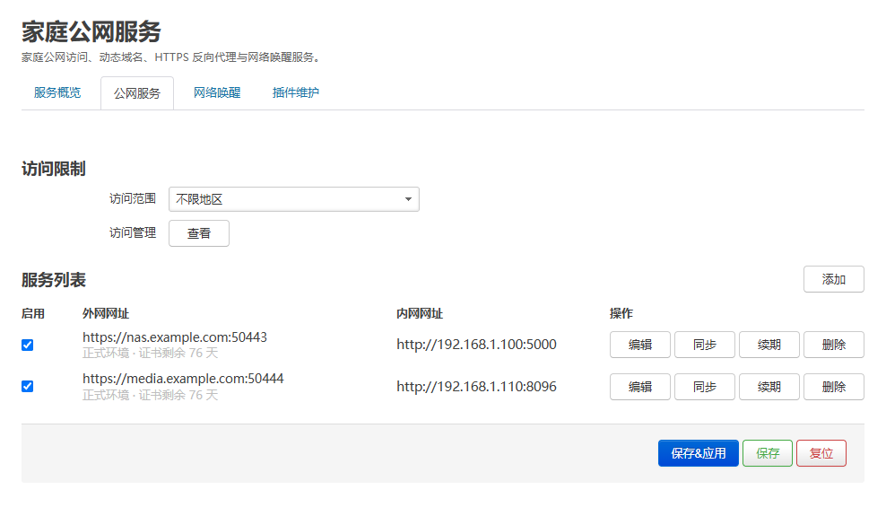
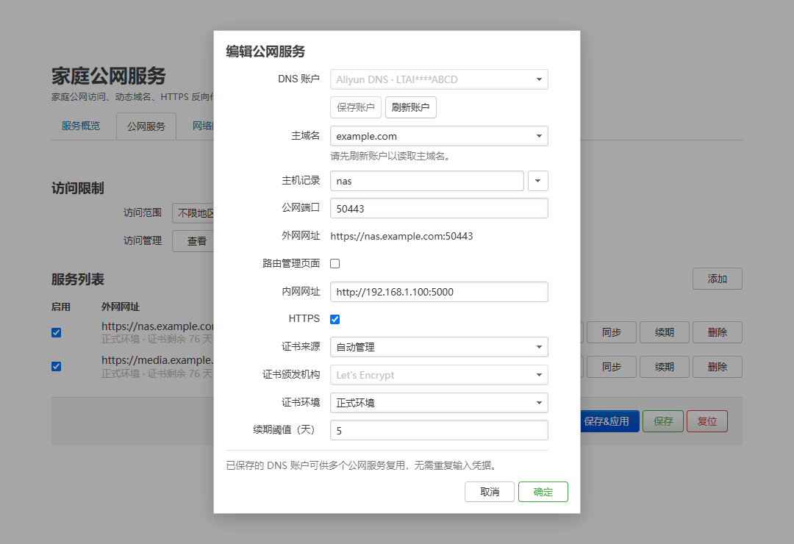

# HomeGate

在 OpenWrt / QWRT 路由器上管理家庭公网服务。用自己的域名访问 NAS、家庭服务器或其他内网设备，并在 LuCI 管理动态 DNS、HTTPS 证书和网络唤醒。

[添加公网服务](#添加公网服务) · [网络唤醒](#网络唤醒) · [维护与排查](#维护与排查) · [源码构建](#源码构建)



## 添加公网服务

以下以将 `https://nas.example.com:50443` 转发到 `http://192.168.1.100:5000` 为例。

1. **保存 DNS 账户。** 在「公网服务 → 添加」中选择腾讯云 DNSPod、阿里云或 Cloudflare，填入该服务商的 DNS 凭据，再点「保存账户」。在弹窗里等到账户保存结果。已有账户时可点「刷新账户」读回云端记录。
2. **填写地址。** 选择主域名 `example.com`，在「主机记录」输入 `nas`，填入公网端口 `50443` 和内网网址 `http://192.168.1.100:5000`。可从主机记录下拉列表选择已有记录。
3. **设置 HTTPS。** 勾选 HTTPS 后，可以让 HomeGate 自动申请证书，也可以上传已有证书。日常访问用正式环境。测试环境适合验证签发流程，其证书可能不受浏览器信任。
4. **应用并启用。** 在弹窗点「确定」，勾选这条服务的「启用」，再点「保存并应用」。确认「服务概览」的 HomeGate 总开关已启用。自动申请的证书会在后台办理，可在公网网址下方查看状态。
5. **分别验证内外访问。** 用手机网络访问示例中的 HTTPS 地址，再从局域网 Wi-Fi 验证同一个地址。看到页面和有效证书后，公网转发才算验收完成。

<details>
<summary>查看公网服务配置示例</summary>



</details>

> 「保存」暂存更改，「保存并应用」提交并生效，「复位」撤销当前页面尚未保存的更改。

## 网络唤醒

进入「网络唤醒」，选择与目标设备相连的局域网接口。添加设备名称和 MAC 地址，保存并应用后，点击该设备的「唤醒」。目标设备需支持 WOL，并在关机或休眠时保持网卡供电。

## 维护与排查

| 遇到的情况 | 查看位置 |
| --- | --- |
| 外网打不开 | 先看「服务概览」是否运行，再到「公网服务」确认条目已启用。核对域名的 AAAA 记录、实际公网端口和内网服务是否可用。 |
| 证书正在签发或稍后重试 | 在公网网址下方查看状态，到「插件维护 → 运行日志」查看签发或重试原因。 |
| 需要限制访问来源 | 在「公网服务 → 访问限制」选择地区范围。进入「查看」可核对访问记录和手动允许或拒绝规则。 |
| 检查更新 | 点「服务概览」版本旁的圆点查看结果。自定义更新源在「插件维护 → 更新地址」。确认更新前先阅读发布说明。 |
| 备份配置 | 在「插件维护」导出配置。导出文件排除 DNS 密钥和证书私钥，恢复到新设备时需重新补齐。 |

## 源码构建

使用 Linux 和 Python 3.12 或更新版本。`make check` 核对版本与原生打包输入，`make frontend` 从 LuCI 模板重新生成 JavaScript。仓库里的 QWRT 清单为构建候选，完成目标 SDK、包格式和设备验收后才能用于正式构建。

```sh
make check
make frontend
python3 scripts/目标SDK构建.py --target targets/qwrt-r26.3.8-ipq807x.json --luci lua --format ipk
```

GitHub Actions 可手动执行源码核对与匹配目标的构建。许可和第三方组件来源见 [LICENSE](LICENSE) 与 [THIRD_PARTY_NOTICES](THIRD_PARTY_NOTICES)。
